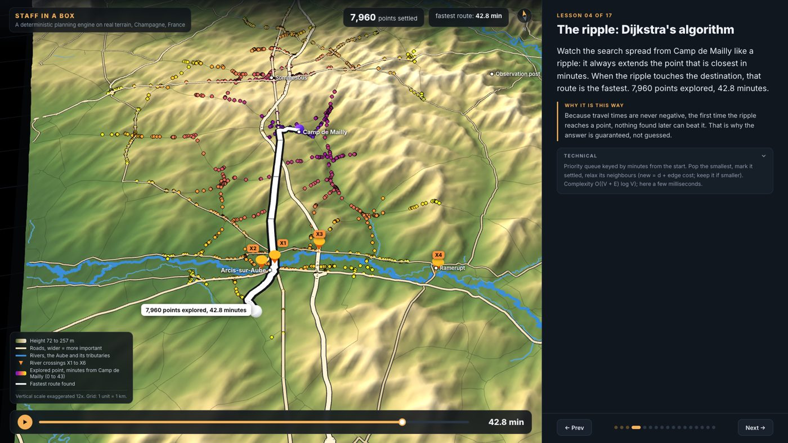
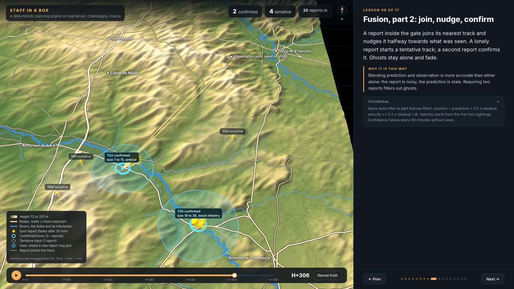
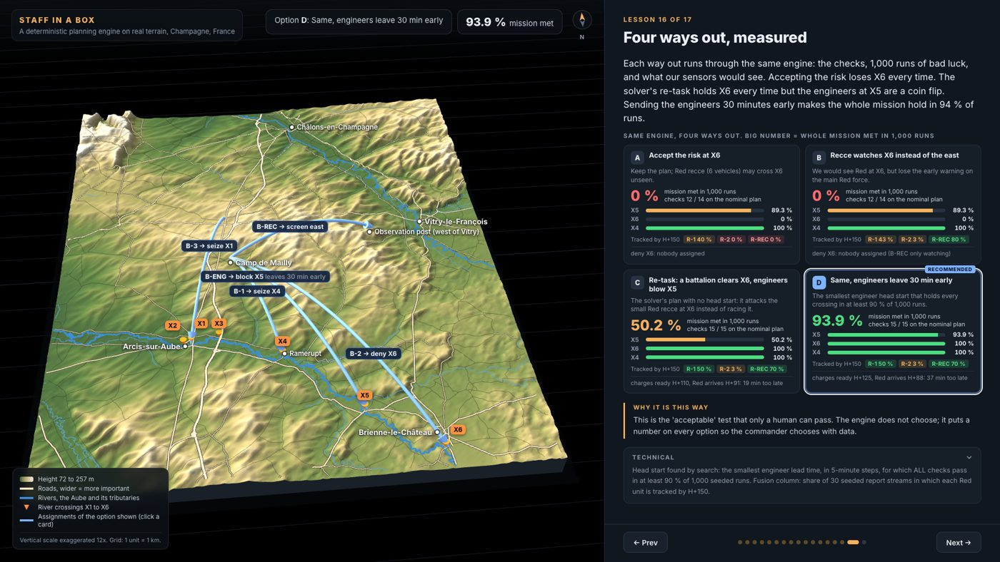

# Staff in a box

A small command post for one fictional brigade exercise on real terrain (the Aube valley, France). It takes in noisy
radio reports, builds a picture of the enemy, assigns units to tasks, checks the plan against the mission, and measures
how the plan survives bad luck. Every decision comes from a deterministic method (graph search, filtering, constraint
programming, seeded simulation), with no language model involved. Each one can be traced to a rule or a number.



## Five questions, five methods

| Question | Method | Result on the scenario |
|---|---|---|
| How fast can we get there? | Dijkstra on the OpenStreetMap road graph (54,077 points), per-unit speed caps, bridges that can be cut | Camp de Mailly to the Arcis bridges: 42.8 min. Blow both town bridges: 64.2 min via the D65 upstream |
| Where is the enemy? | Report fusion: prediction, gating (distance and plausible speed), alpha-beta filter, coasting, re-identification, track merging | 43 noisy reports (4 of them ghosts) become exactly 2 confirmed tracks, one per Red unit seen |
| Who should go where? | OR-Tools CP-SAT: one task per unit, eligibility rules, fuel reserve; minimise the latest ready time | OPTIMAL in about 20 ms. The slowest unit (armour) takes the nearest bridge |
| Did we forget something? | Validator written against the mission, not against the task list | Caught a mission bridge (X6) that the first task list left uncovered |
| Will it survive bad luck? | Monte Carlo, 1,000 seeded runs (late starts, slow roads, early or fast enemy) | First plan holds the key bridge in 89 % of runs vs 48 % for the intuitive plan |



## How the hole in the plan was handled

The mission said "deny X5 and X6"; the first task list only had X5. The mission-based validator flagged it, and the
first solver verdict was "infeasible, short by 17 minutes". That verdict came from a bug: the solver and the validator
each had their own copy of the race rule, and the two copies had drifted apart. With one shared rule (`validate.race_ok`)
the engine produced and measured four options:

| Option | Mission met (1,000 runs) |
|---|---|
| A. Accept the risk at X6 | 0 % |
| B. Recce watches X6 instead of the east | 0 % (but Red recce is seen in 80 % of report streams) |
| C. Re-task: a battalion clears X6, engineers demolish X5 | 50 % |
| D. Same, engineers leave 30 min early (smallest head start reaching 90 %, found by search) | 94 % |



## Fusion took six versions

`docs/fusion-log.md` records each measured failure and the one change that fixed it. Examples: one-to-one matching
(the Hungarian algorithm) fragments tracks because human reports duplicate. Extrapolating speed after a column stops
loses it. An uncapped gate lets ghost reports confirm each other. Current scoreboard over 30 seeded report streams:
1.2 tracks per Red unit, about 1 km position error, 0 to 0.07 false tracks per run.

## Scope

Planning, situational awareness and logistics only. A human decides everything, and every suggestion cites its source.
No targeting, no imagery of real forces, no real orders of battle. The forces are fictional; the terrain and the
doctrine (five-paragraph orders, planning ratios) are public.

## Run it

```bash
python3 -m venv .venv && .venv/bin/pip install networkx shapely ortools numpy pillow pytest
scripts/fetch_data.sh                       # OpenStreetMap roads and rivers (elevation tiles are in data/dem)
.venv/bin/python -m pytest -q tests         # 9 tests: determinism, optimality, mission coverage, robustness
.venv/bin/python -c "from sib import export; export.build()"   # regenerate viewer/data.js
open viewer/index.html                      # 17-step 3D explainer (Three.js)
```

- `sib/`: the engine. `roads`, `terrain`, `sim` (ground truth), `reports` (seeded noisy reports), `fusion`, `assign` (CP-SAT), `validate`, `montecarlo`, `options`, `export`.
- `viewer/`: the 3D explainer, with recording hooks for video.
- `lab/`: an in-browser lab (Pyodide) where each method is rebuilt by hand and checked against the engine.
- `explain/`: four click-through explainers in plain language: grouping reports, the solver, vehicle routing, Monte Carlo.

## Not modelled yet

Off-road movement, communications loss, enemy deception and morale. Prediction along roads instead of straight lines,
and re-planning from the current picture when a unit is late, come next.

## Data

Roads and rivers © OpenStreetMap contributors, ODbL. Elevation: Terrain Tiles on AWS (Mapzen/Linux Foundation; sources
include SRTM, NASA, USGS). Planning speeds and ratios are stated assumptions in `scenario/aube.json`.
